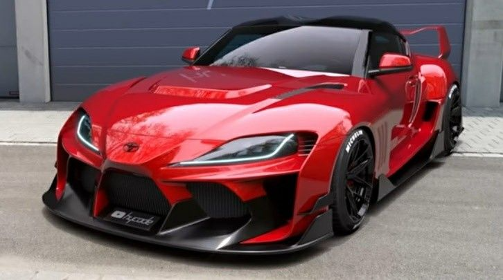
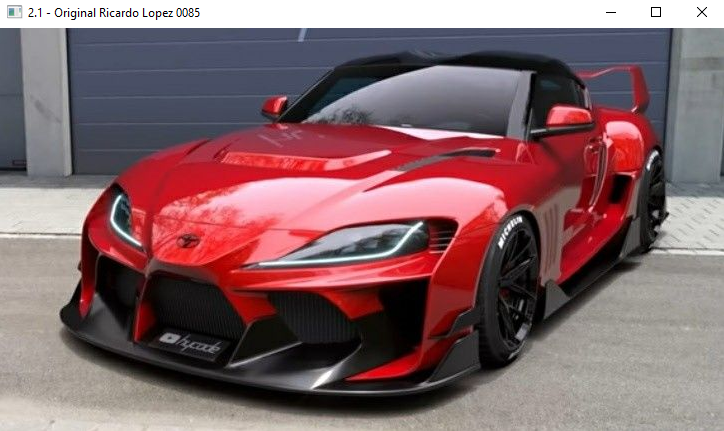
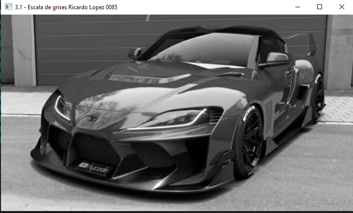
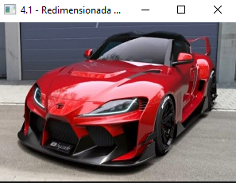
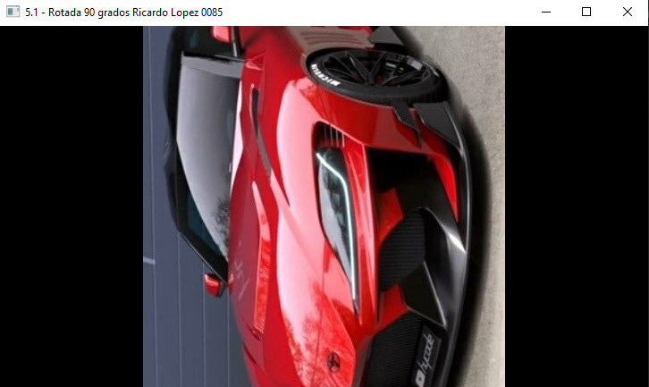
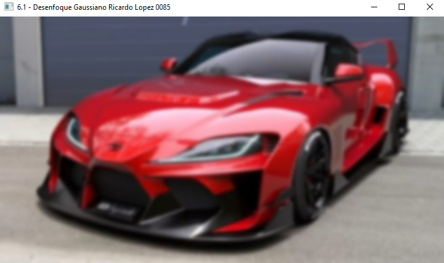
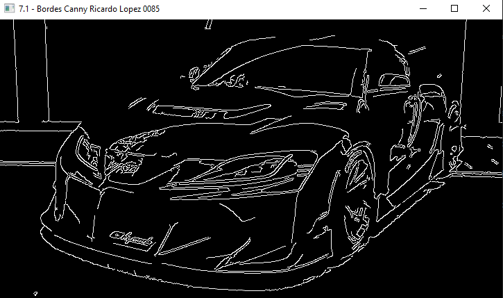
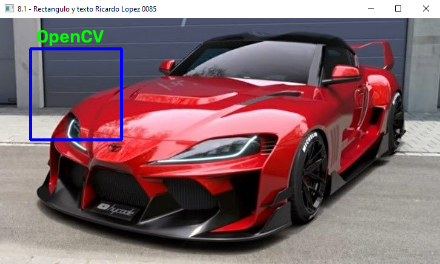
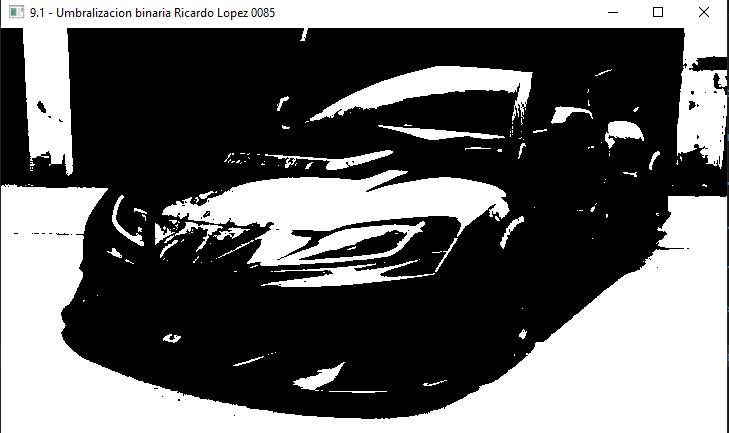
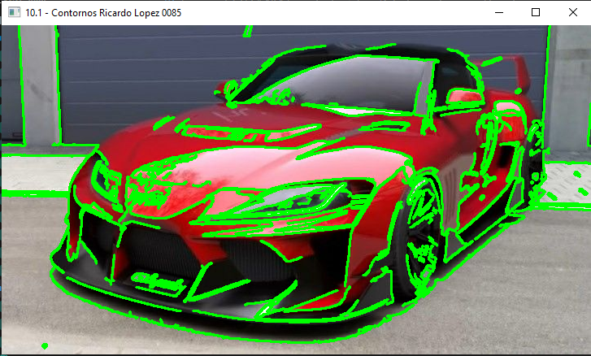

## Carrorojo Ricardo Lopez 0085
# img orig

# 2.1 Ejemplo de código:

# 3.1 Ejemplo de código: Convertir una imagen a escala de grises

# 4.1 Ejemplo de código: Cambiar el tamaño de la imagen

# 5.1 Ejemplo de código: Girar la imagen 90 grados.

# 6.1 Ejemplo de código: Aplicación de un desenfoque gaussiano

# 7.1 Ejemplo de código: Detección de bordes mediante el algoritmo de Canny

# 8.1 Ejemplo de código: Dibujar un rectángulo y añadir texto.

# 9.1 Ejemplo de código: Aplicar umbralización binaria

# 10.1 Ejemplo de código: Detectar contornos y dibujarlos
